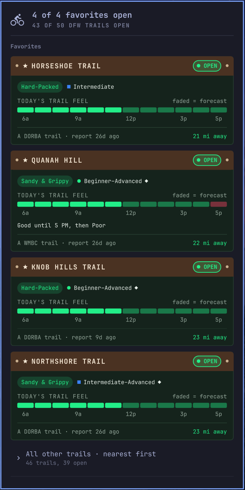
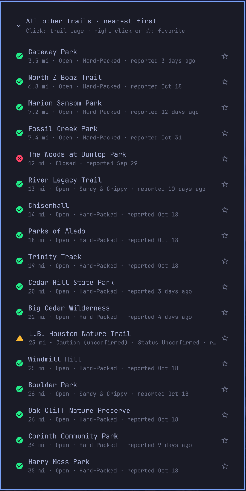

# DFW MTB Trail Hub for Omarchy

Dallas–Fort Worth mountain bike trail status in your Omarchy bar. Star the trails you ride and the
bar shows how many of them are open ("2/3 open"); click it for every trail's status, the dirt, when
the status was reported and how far away each trail is, and get a notification when one of your
trails opens or closes.


Trail data comes from [DFW MTB Trail Hub](https://dfwmtbtrailhub.com), which follows 50 trail
systems around Dallas–Fort Worth: each trail's status as its club posted it, an hourly weather
model of the dirt, and reopening estimates for closed trails. A closure posted at the trailhead
overrides it.

```bash
omarchy plugin add https://github.com/Gleasonmt/omarchy-dfw-mtb --enable
```

## What it shows

<table>
  <tr>
    <th>Your favorites</th>
    <th>Every other trail</th>
  </tr>
  <tr>
    <td valign="top"></td>
    <td valign="top"></td>
  </tr>
</table>

**The bar** shows one of these (change it under **Filter options** in the panel):

| Show in bar | Bar |
|---|---|
| Your favorites (default) | `2/3 open`, or every trail's count until you star some |
| How many trails are open | `43 open` |
| Your nearest trail | `Arbor Hills · open` |

**Your favorites** are drawn like the trail tiles on dfwmtbtrailhub.com: the trailhead sign with
an OPEN, CAUTION or CLOSED badge, the dirt in the site's colors (purple epic, green good, amber fair,
red poor or closed), the difficulty with the site's symbols, today's trail feel hour by hour
(forecast hours faded), the club that maintains it, when its status was reported, and how far away
it is.

**Every other trail** follows as a compact row (nearest first, by name, or open first): its
distance, status, dirt, a reopening estimate when it's closed, and always when its status was
reported. Below them are the latest status changes and a link to the site.

- Click a trail (or a tile) to open its page on DFW MTB Trail Hub.
- Right-click it, or click its ☆, to make it a favorite (or not).
- In the panel, the arrow keys move, Enter opens, `f` stars the trail under the cursor and `r`
  refreshes. Middle-click the bar to refresh.

**Alerts**: when one of your favorites opens, closes or goes to caution, you get one notification
(one, however many monitors you have); click it for the trail's page. Under Filter options you can
switch alerts to any trail, or off. Installing the widget or restarting the shell doesn't replay
old changes.

## How it works

- **Trails** come from DFW MTB Trail Hub's public API (`/api/v1/trails` and
  `/api/v1/status-changes`, plus `/api/v1/trails/<trail>` for each favorite's hourly dirt),
  downloaded when the cached copy is more than 15 minutes old, or when you refresh, into
  `${XDG_CACHE_HOME:-~/.cache}/gleasonmt-dfw-mtb/`. Every monitor's bar shares that copy and one
  download. A trail that stops being a favorite has its file removed after 30 days.
- **Your location** (for distances and "nearest") is your Weather location: the place you set in
  the Weather panel (or with `omarchy-weather-location`). Only with no Weather location at all does
  it use the city [geo.omarchy.org](https://geo.omarchy.org/) places your network in, the same
  lookup the Weather panel makes.
- **Alerts** are recorded as empty files in
  `${XDG_STATE_HOME:-~/.local/state}/gleasonmt-dfw-mtb/notified/` so each change is announced once;
  records are removed after 60 days.

## Dependencies and network

Everything it needs comes with Omarchy: `curl` and `bash` to fetch, `omarchy-launch-browser` to
open links, `omarchy-notification-send` for alerts, and `omarchy-bar` to save the settings you
change in the panel. It makes three kinds of request, all plain HTTPS GETs:

- `dfwmtbtrailhub.com/api/v1/trails` (capped at 2 MB; about 130 KB),
  `dfwmtbtrailhub.com/api/v1/status-changes` (capped at 500 KB; about 17 KB) and, for each
  favorite, `dfwmtbtrailhub.com/api/v1/trails/<trail>` (capped at 200 KB; about 9 KB), at most
  every 15 minutes
- `geo.omarchy.org`, only when no Weather location is set at all, at most once a day (capped at
  4 KB)

The answers are read as JSON, every field is cut to a length the panel can show, links are only
ever followed to dfwmtbtrailhub.com, and nothing downloaded is ever run. A trail's name has `<`,
`>` and `&` swapped for look-alike characters before it goes into a notification, so nothing in it
can format the notification or add a link of its own. Cached files and alert records are readable
only by you. Alerts carry only public trail data, never your location.

## Settings

Under **Filter options** at the bottom of the panel: **Show in bar**, **Alerts**, **Sort** and
**Units**. Click for the next choice, right-click (or the arrow keys) for the one before. Everything
can also be set from a terminal, and the widget updates right away:

```bash
omarchy bar set gleasonmt.dfw-mtb barMode count --json         # or favorites, nearest
omarchy bar set gleasonmt.dfw-mtb alerts all --json            # or favorites, off
omarchy bar set gleasonmt.dfw-mtb sort status --json           # or nearest, name
omarchy bar set gleasonmt.dfw-mtb favorites '["northshore-trail","knob-hills-trail"]' --json
```

| key | default | |
|---|---|---|
| `barMode` | `"favorites"` | `favorites`, `count` or `nearest` |
| `alerts` | `"favorites"` | `favorites`, `all` or `off` |
| `sort` | `"nearest"` | `nearest`, `name` or `status` (open first) |
| `unit` | `"mi"` | `mi` or `km` |
| `favorites` | `[]` | trail slugs, as in each trail's address on the site |

## Removing

```bash
omarchy plugin remove gleasonmt.dfw-mtb
rm -rf "${XDG_CACHE_HOME:-$HOME/.cache}/gleasonmt-dfw-mtb" "${XDG_STATE_HOME:-$HOME/.local/state}/gleasonmt-dfw-mtb"
```

## Development

The logic lives in `Model.js`, the downloads in `fetch.sh` and the send-once alert in `notify.sh`;
all three are tested under Node (the script tests use a stub `curl` and a stub
`omarchy-notification-send`). Where Omarchy is installed, a test also runs alert text through
Omarchy's own notification markup code:

```bash
node --test tests/*.test.mjs
```

## Credit and license

Trail data: [DFW MTB Trail Hub](https://dfwmtbtrailhub.com). Weather data by Open-Meteo.com. Trail
lengths and drive times: © OpenStreetMap contributors, ODbL.

The plugin is MIT licensed.
